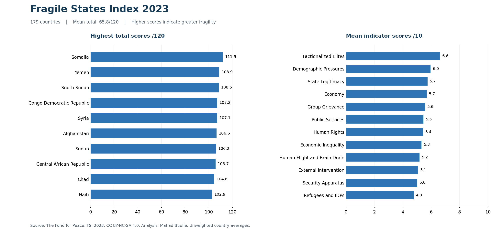
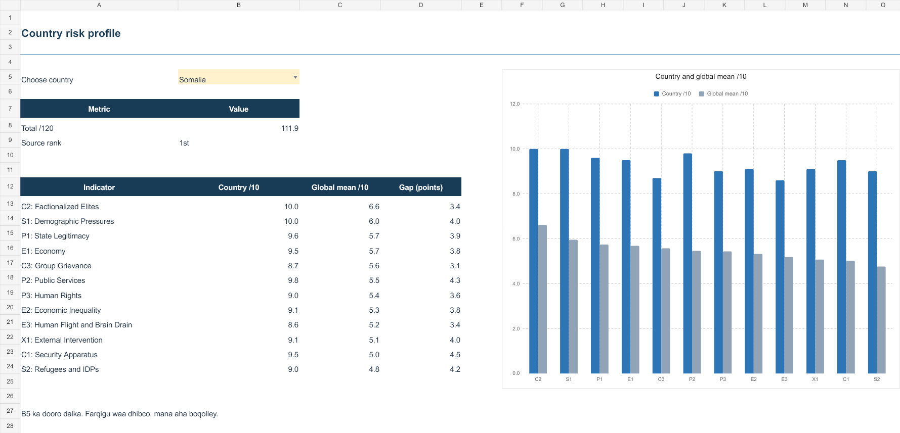

# Fragile States Index 2023 Analysis

An Excel and Python analysis of 179 countries and 12 fragility indicators, with a country selector, comparison charts, a heatmap and data quality checks.

**Author:** [Mahad Buulle](https://github.com/MahadBulle)  
**Tools:** Microsoft Excel, Python, openpyxl, matplotlib  
**Scope:** Educational data analysis project using the 2023 Fragile States Index, published by **The Fund for Peace**.



## Questions

1. Which countries have the highest total fragility scores?
2. Which indicators have the highest average scores across the countries in this dataset?
3. How does a selected country's indicator profile compare with the dataset average?
4. Are the source records complete, unique and internally consistent?

## Key findings

| Measure | Result |
| --- | ---: |
| Countries | 179 |
| Indicators per country | 12 |
| Mean total score | 65.8 / 120 |
| Median total score | 68.2 / 120 |
| Highest total: Somalia | 111.9 / 120 |
| Second highest: Yemen | 108.9 / 120 |
| Third highest: South Sudan | 108.5 / 120 |
| Lowest total: Norway | 14.5 / 120 |
| Highest mean indicator: Factionalized Elites | 6.62 / 10 |

Somalia scores 10.0 on both Demographic Pressures and Factionalized Elites, and 9.8 on Public Services. These identify areas for closer contextual research. Indicator averages describe recorded pressures; they do not establish what caused fragility.

## Open the Excel dashboard

Download [the Excel workbook](reports/FSI_2023_Analysis.xlsx) and open it in desktop Excel.

| Sheet | Purpose |
| --- | --- |
| Dashboard | Key statistics, top 10 countries and indicator averages |
| Country Profile | Choose a country in yellow cell **B5** to update its scores and comparison chart |
| Data | Original 16 fields, a filterable Excel Table, indicator heatmap and calculation columns |
| Quality | Source audit results and methodology notes |

The workbook uses formulas and native charts. It does not contain macros, slicers or new PivotTables. Original practice workbooks are not included or modified.



## Method

- Retain one record per country for 2023 and preserve the supplied values.
- Validate country-year uniqueness, missing fields and indicator scores from 0 to 10.
- Reconcile each reported total against the sum of its 12 indicators, using a tolerance of 0.00000001 for floating point precision.
- Rank countries by total, with source order resolving tied totals in the displayed top 10.
- Calculate unweighted indicator averages across all 179 countries.
- Compare the selected country's score with each indicator average in **score points**, not percentage changes.
- Apply display rounding only. No records were dropped or imputed.

All 179 source records passed the stated checks: no missing fields, duplicate country-year keys, out-of-range indicator scores or total reconciliation failures.

## Reproduce the analysis

Requires Python 3.10 or later. From the repository root:

```bash
python -m venv .venv
# Windows PowerShell
.venv\Scripts\Activate.ps1
# macOS / Linux: source .venv/bin/activate
python -m pip install -r requirements.txt
python scripts/analyze.py
```

The script reads the original fields embedded in the workbook's `Data` sheet, reruns the source checks, writes summary CSV/JSON files to `reports/`, and regenerates `images/overview.png`. It does not recreate or modify the Excel workbook. An optional `--input` argument accepts the original FSI Excel download instead.

## Limitations

- Only 2023 is included. This is a cross-country comparison, not a time trend or a description of current conditions.
- Higher scores indicate greater fragility. Total scores run from 0 to 120; indicators run from 0 to 10.
- Dataset averages give every country equal weight. They are not population-weighted estimates.
- No region or population fields were supplied, so regional and population analyses are not inferred.
- Excel formulas cover the existing 179 records. Extend their ranges when adding countries. The indicator table retains its baseline sort order after edits; re-sort it when necessary.
- Quality-sheet results and PNG previews are snapshots. Run the Python script again after source changes.
- Formulas and the country selector were checked in the generation engine, and the exported workbook was inspected programmatically. Native desktop Excel recalculation has not been independently verified.

## Data attribution and reuse

**Fragile States Index 2023 — The Fund for Peace.**

- [Official Excel data downloads](https://fragilestatesindex.org/excel/)
- [2023 annual report](https://fragilestatesindex.org/wp-content/uploads/2023/06/FSI-2023-Report_final.pdf)
- [Publisher's reuse terms](https://fragilestatesindex.org/contact-us/request-to-republish-material/)
- [CC BY-NC-SA 4.0](https://creativecommons.org/licenses/by-nc-sa/4.0/)

The publisher identifies its material as CC BY-NC-SA 4.0. This educational project credits The Fund for Peace and shares data-derived workbook content, charts and analysis under that same license. Changes comprise analytical summaries, formulas, formatting, charts and documentation; supplied source values are preserved. No endorsement by The Fund for Peace is implied. Commercial reuse requires reviewing the publisher's terms and obtaining any necessary permission.

The Python code is licensed separately under MIT; see [LICENSE](LICENSE). That code license does not relicense the underlying data or the data-derived artifacts.
